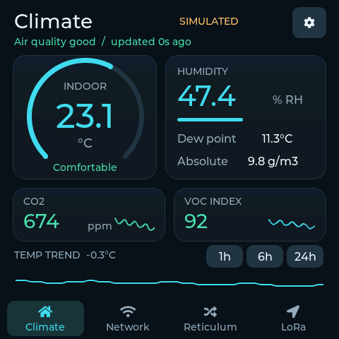
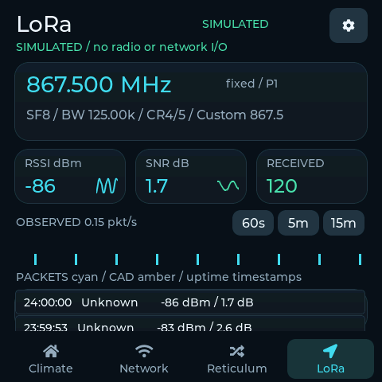

# SenseCAP / Smart Dashboard

Native C++17 / ESP-IDF **5.1.6** / LVGL **8.3.1** application for Seeed's
SenseCAP Indicator **D1S**, with a shared desktop renderer, real RP2040 sensor
input, local network checks and an independently buildable passive XIAO LoRa receiver.





*LoRa monitor preview with simulated packets; not a live radio capture.*

**This is not a hardware-qualified production release.** Builds and desktop tests
are reproducible; see [verification](docs/verification.md) for actual hardware
results and remaining acceptance work. Optional module clients are not silently
pretended to work.

**On-device result:** ESP32 flashed successfully; real UART readings from all4
sensors confirmed. User verified working touch and stable page switching after
restoring Seeed's display/memory baseline. Original8MB firmware is privately
backed up. RP2040 firmware was not modified. Wi-Fi/MQTT service tests and long-run
qualification remain to be performed with your configured local services.
The follow-up input-scheduling build was also flashed and user-confirmed
**responsive for navigation and typing**. See [display/touch investigation](docs/display-debugging.md).

## Implemented

* 480 × 480 dark UI, animated temperature arc, humidity bar, CO2/VOC status,
  dew point, absolute humidity, comfort badge and temperature trend.
* Real AHT20/SCD41/SGP40 values from stock RP2040 firmware over bounded COBS UART
  parsing. Missing/stale values show `--`, never synthetic fallback data.
* 1h / 6h / 24h in-memory history, per-metric minute averages and missing-data gaps.
* Four navigation sections; touch, swipe, card details and long-press settings.
* Wi-Fi reconnect/backoff, IP/gateway/DNS/RSSI, uptime, heap and MQTT status.
* Four configurable TCP or HTTP HEAD health checks, latency charts and last-success
  information in host details. Monitoring runs outside the UI task.
* NVS configuration, on-screen keyboard, brightness, physical-button-only screen
  blank/wake (no idle blanking), optional page rotation,
  thresholds, MQTT publishing and optional local NTP for TLS certificate validation.
* Independent, authenticated, read-only Linux Reticulum bridge and security tests.
* [Passive XIAO ESP32-S3 + Wio-SX1262 receiver](docs/lora.md), authenticated local
  WebSocket telemetry and D1S LoRa UI: fixed/scan/CAD modes, bounded history,
  RSSI/SNR, activity, raw HEX and conservative classification. **Both devices
  flashed; XIAO received three CRC-valid packets on Meshtastic EU868 Long Fast.
  Dashboard connection and basic packet display confirmed by the user;
  sequence comparison and long-run reliability still need acceptance.**
* SDL desktop LVGL simulator; **synthetic data only with `--simulate`**.
* LoRa settings redesign (flashed and boot-checked; physical UI confirmation pending): Connection and
  Receiver sections, switches/presets, readable units and separate apply/save
  actions. [Connection preview](docs/previews/lora-settings-connection.png) ·
  [Receiver preview](docs/previews/lora-settings-receiver.png).
* SenseCAP USB pairing: load the XIAO access token directly from a private file,
  without typing it. Narrow link-only NVS update preserves Wi-Fi/host/radio settings;
  see [setup](docs/lora.md).
* XIAO USB diagnostics: inspect live Wi-Fi signal, IP, retries and disconnect
  reasons without Wi-Fi or a token via `scripts/sniffer-serial.py watch`.
  See [USB commands](lora-sniffer/README.md#usb-connection-diagnostics).

## Deliberately deferred

The Reticulum **device client**, remote CPU/memory/disk telemetry input,
MQTT Home Assistant auto-discovery, ICMP, OTA and SD-backed history are later
milestones. The Reticulum tab shows honest inactive-module information. The bridge
exists independently; its URL/token settings are reserved, not an active client.
There is no LoRa transmission or internal SX1262 initialization on D1S. Host checks
are TCP connect / HTTP HEAD, not ping and not proof an entire machine is healthy.
CPU utilization and Wi-Fi byte counters are not fabricated.

## Build firmware

Requirements: Git, Python 3, Docker. No system ESP-IDF installation is required.
From this directory:

```sh
python3 scripts/bootstrap.py
bash scripts/build.sh
```

`vendor.lock.json` pins upstream repositories and the IDF image digest.
Bootstrap refuses to discard existing vendor changes. The BSP/LVGL remain upstream
code. Vendor-only legacy format warnings are documented in
[hardware findings](docs/hardware.md); application warnings remain strict.
Display settings deliberately retain Seeed's120MHz+PSRAM-XIP baseline and10ms
panel scanout task, independently of LVGL's33ms render budget. Do not reduce the
panel scanout to30Hz just because UI animations target30FPS.

With native IDF **v5.1.6** installed, source its `export.sh`, run bootstrap, then:

```sh
idf.py build
idf.py size
```

Artifacts: `build/sensecap_dashboard.bin`, `.elf`, bootloader and partition table.
Do not flash the application `.bin` at address zero. Follow
**[backup, flashing and recovery](docs/flashing.md)** before any upload.

## Desktop development and tests

Requires a C/C++ compiler, CMake >=3.16, pkg-config, SDL2 development files, Python
>=3.10. On Debian/Ubuntu install `build-essential cmake pkg-config libsdl2-dev`;
on Arch use `base-devel cmake pkgconf sdl2` (or your distribution's SDL2 provider).

```sh
cmake -S desktop -B build-desktop -DCMAKE_BUILD_TYPE=Debug
cmake --build build-desktop --parallel 8
ctest --test-dir build-desktop --output-on-failure
build-desktop/simulator --simulate
build-desktop/simulator --unavailable
bash scripts/previews.sh
```

Mouse acts as touch; drag horizontally to swipe. Arrow keys also switch tabs.
Desktop settings live in RAM only; it never connects to Wi-Fi/MQTT or stores
credentials. Headless screenshot/self-test mode needs neither a screen nor SDL
video initialization. Previews are actual software-rendered **shared LVGL code**,
not design illustrations. They are not device photographs.

Core-only tests without SDL (run bootstrap first for pinned cJSON):

```sh
cmake -S desktop -B build-core -DDASH_BUILD_SIMULATOR=OFF
cmake --build build-core
ctest --test-dir build-core --output-on-failure
```

Sanitizer build: add `-DDASH_SANITIZE=ON` to a separate desktop build directory.
LVGL process-lifetime allocations can be excluded from leak checking with
`ASAN_OPTIONS=detect_leaks=0`; address/undefined checks remain enabled.

## First-use configuration

1. Attach the external Grove AHT20 correctly; allow the RP2040/CO2 sensor to start.
2. Open the gear button. Set Wi-Fi SSID/password; leave external services empty if
   not needed. Scroll the form; tap an input for the keyboard, its checkmark to close.
3. Save. An asynchronous worker writes NVS and reboots **only on successful commit**.
   A save error is logged; the old settings remain in effect. The UI's queued
   message acknowledges the request, not a completed write.
4. Add host friendly names/addresses. For TCP use an IPv4 address or hostname and
   port. For HTTP choose check `1` and enter a full `http://...` or `https://...`
   URL, including the port/path. HTTP uses the URL's port, not the TCP port field.
   On Network, long-press a host to edit **that host only**. Short-tap a configured
   host for details and its Edit button; short-tap an empty slot to configure it.
   Overlays block background taps/swipes until closed.
5. For MQTT set `mqtt://broker:1883` or certificate-verified `mqtts://...:8883`,
   credentials and a unique device ID. See [MQTT payloads](docs/mqtt.md) and
   [Home Assistant example](examples/home-assistant.yaml).

Monitor only hosts you are authorized to check. HEAD must return 2xx; endpoints
that reject HEAD should use TCP or a dedicated HEAD-compatible health endpoint.
HTTP redirects are not followed. Serial host checks run every ~10s plus check
duration; a TCP/HTTP check has a 1.5s socket/client timeout, with DNS governed by
lwIP's own resolver retry limits. This never blocks LVGL.

### Defaults and ranges

| Setting | Default | Accepted |
|---|---:|---|
| UI refresh | 1000 ms | 250–60000 ms |
| Stale timeout | 20000 ms | 15000–300000 ms |
| MQTT publish | 30 s | 5–3600 s |
| Brightness | 85% | 5–100% |
| Screen timeout | 120 s | 0 disables; up to 3600 s |
| Page rotation | disabled | 0 or >=10 s; rotates Climate/Network only |
| CO2 warning / critical | 1000 / 1500 ppm | 400 <= warning < critical <=40000 |
| VOC warning / critical | 150 / 250 | 1 <= warning < critical <=500 |
| Comfort temperature | 18–27 °C | -40 <= low < high <=85 |
| Comfort humidity | 30–65% | 0 <= low < high <=100 |

UI refresh and publish intervals **do not alter the stock RP2040 acquisition
cadence**, approximately 5 seconds. The checked RP2040 sketch declares an interval
command but does not implement it. This application does not send it or change
SGP40 algorithm timing. VOC index 0 is warm-up/unavailable, not perfect air quality.
On the tested stock RP2040 firmware a fresh reset required about**4minutes**
before the first nonzero VOC index. The ESP32 leaves it unavailable during that
period; this is not a reason to flash the coprocessor.
Warnings are indicative, not health/safety certification.

Settings persist in unencrypted local NVS by default. Password inputs are masked
and credentials are never logged. Physical extraction remains possible; production
provisioning must add flash/NVS encryption and secure boot using an audited key
process. No keys/eFuses are programmed by this project. MQTT/HTTP plaintext is
appropriate only on a trusted isolated LAN; use TLS otherwise. TLS requires a
valid clock: configure a reachable **local NTP server** and trusted certificate
chain. No public time server, cloud service or internet connection is required.
Private/self-signed CAs require a deliberately provisioned CA rather than disabling
certificate checks; custom-CA UI provisioning is not implemented yet.

## Documentation

* [Hardware inspection and software versions](docs/hardware.md)
* [Architecture and extension boundaries](docs/architecture.md)
* [Backup, ESP32 flashing and RP2040 recovery](docs/flashing.md)
* [MQTT contract / Home Assistant](docs/mqtt.md)
* [Reticulum bridge deployment](bridge/README.md)
* [XIAO LoRa setup, receive-only boundary and verification](docs/lora.md)
* [LoRa WebSocket protocol](docs/lora-protocol.md)
* [Milestones and verification](docs/verification.md)
* [Network preview](docs/previews/network.png) · [Unavailable sensors](docs/previews/unavailable.png)

Application code: MIT; reused display-port portions: Apache-2.0. Upstream vendor
code retains its original licenses. See [THIRD_PARTY.md](THIRD_PARTY.md).
